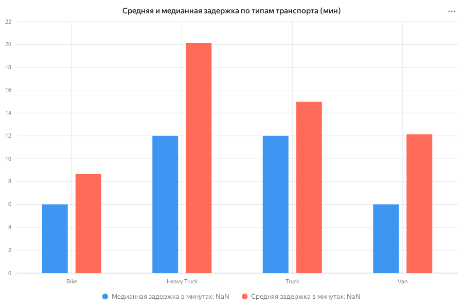
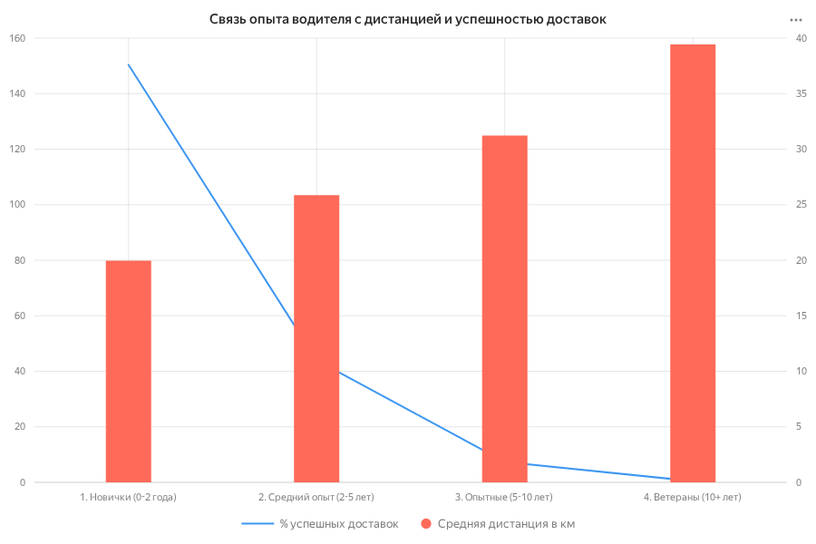
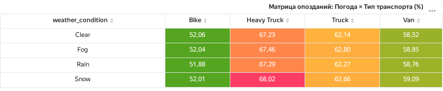

# 🚚 Анализ задержек и стоимости логистических доставок

## 📌 О проекте (TL;DR)
Данный проект представляет собой исследовательский анализ данных (EDA) логистической компании на основе синтетического датасета (450 000+ записей). 
**Цель:** Выявить узкие места, влияющие на опоздания (delay_minutes) и стоимость доставки, а также сформулировать бизнес-рекомендации по оптимизации логистических процессов.

## 📊 Ключевые инсайты
*   **Heavy Truck — самый проблемный транспорт**: Процент опозданий для тяжелых грузовиков достигает **~67%**, что значительно выше, чем у легкого транспорта (например, у Bike — ~52%). Это указывает на возможные проблемы с маршрутизацией или заниженные SLA для тяжелого транспорта.
*   **Влияние погоды**: Двумерный анализ выявил, что комбинация неблагоприятных погодных условий с определенными типами транспорта дает рекордный процент опозданий (детальный анализ в скриптах).
*   **Парадокс опыта водителей**: Ветераны с опытом 10+ лет имеют более низкий процент успешных доставок по сравнению с новичками. *Гипотеза:* им доверяют более сложные, дорогие или дальние маршруты.
*   **Динамика затрат**: С помощью оконных функций выявлены пиковые дни по расходам на доставку, а также рассчитано скользящее среднее за 3 дня для сглаживания ежедневных колебаний.

## 🗂️ Структура репозитория
*   `sql/` — SQL-скрипты с анализом:
    *   `01_exploratory_analysis.sql` — базовые метрики, процент опозданий, топ-3 дорогих доставок (оконные функции).
    *   `02_driver_performance.sql` — анализ успешности доставок в зависимости от опыта водителя.
    *   `03_window_functions.sql` — скользящее среднее и разница день ко дню (LAG).
    *   `04_seasonality_analysis.sql` — сезонность по дням недели.
*   `docs/` — документация, описание логики запросов и бизнес-выводы.
*   `visuals/` — *(добавим позже)* Графики и дашборды.
*   `README.md` — Описание проекта.

## 🛠️ Стек технологий
*   **SQL (PostgreSQL)**: Использование CTE (WITH), оконных функций (`ROW_NUMBER`, `LAG`, `AVG OVER`), агрегаций, `CASE`, обработки дат и работы с медианами/средними.
*   **Инструменты визуализации**: *(укажи свой инструмент, например: Excel, DataLens, Power BI или Python/Pandas)*.

## 💡 Бизнес-рекомендации (Actionable Insights)
1.  **Пересмотр SLA для Heavy Truck**: Провести аудит маршрутов тяжелого транспорта и пересмотреть нормативы времени доставки, чтобы снизить стресс и штрафы.
2.  **Аудит распределения заказов**: Проверить, действительно ли ветераны получают более сложные заказы, и если да — внедрить систему наставничества или перераспределить нагрузку.
3.  **Прогнозирование затрат**: Использовать расчеты скользящего среднего (из `03_window_functions.sql`) для более точного бюджетирования логистики на предстоящие периоды.

## 🧹 Качество данных (Data Quality)
В рамках проекта проведен аудит данных:
*   Обработаны пропуски в ключевых полях (если применимо).
*   Отфильтрованы аномальные выбросы в стоимости доставки.
*   Для отсечения статистического шума при группировке (погода + транспорт) использовалось условие `HAVING COUNT(*) > 1000`.

### 📊 Визуализация инсайтов (DataLens)

#### 1. Средняя и медианная задержка по типам транспорта

*Вывод: Средняя задержка у Heavy Truck составляет 20.11 мин, но медиана — всего 12 мин. Это указывает на наличие аномальных выбросов (сверхдолгих задержек), которые требуют отдельного расследования.*

#### 2. Парадокс ветеранов: Сложность маршрутов

*Вывод: Ветераны (10+ лет) получают маршруты в 2 раза длиннее, чем новички (157 км против 80 км). Это полностью объясняет низкий процент успешных доставок у опытных водителей — им просто доверяют самые сложные задачи.*

#### 3. Матрица опозданий: Погода × Транспорт

*Вывод: Даже в ясную погоду (Clear) Heavy Truck опаздывает в 67% случаев. Проблема кроется не в погоде, а в самом типе транспорта.*

## ⚙️ Как воспроизвести анализ
1. Разверните локальную базу данных PostgreSQL.
2. Создайте таблицу `synthetic_transportation` и импортируйте данные.
3. Откройте SQL-клиент (DBeaver, DataGrip или pgAdmin).
4. Выполняйте скрипты из папки `sql/` в порядке их нумерации (от `01` до `04`).
