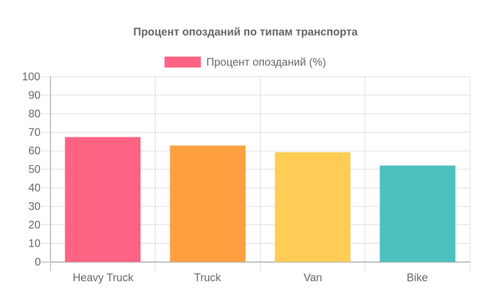

# Анализ задержек и стоимости логистических доставок

## Бизнес-контекст
Логистическая компания несет потери из-за задержек доставки. Цель анализа — выявить узкие места в операционных процессах (на уровне типов транспорта и погодных условий) и найти способы оптимизации затрат.

**Инструменты:** PostgreSQL, DBeaver.

## Данные
Синтетический датасет (450 000 записей), содержащий информацию о маршрутах, типах транспорта, погодных условиях, стоимости и времени доставки. Данные содержат намеренные искажения (MNAR) и выбросы для имитации реальных корпоративных выгрузок.

## Ключевые инсайты и выводы

### 1. Тяжелые грузовики (Heavy Truck) — главный источник задержек

Анализ показал, что независимо от погодных условий, тяжелые грузовики опаздывают в среднем в **67% случаев**. Плохая погода (туман, снег) усугубляет ситуацию незначительно (до 68%). 
*   **Вывод:** Проблема системная. Вероятно, нормативы времени (SLA) для тяжелого транспорта изначально занижены и не учитывают реальное время на погрузку/разгрузку. 
*   **Рекомендация:** Пересмотреть буферное время для маршрутов Heavy Truck.

### 2. Trade-off между стоимостью и скоростью
В пересчете на 1 км самый дорогой транспорт — **Bike** (0.64 у.е.), но он же и самый быстрый (средняя задержка 8.67 мин). Самый дешевый — **Heavy Truck** (0.57 у.е.), но он едет дальше всех (132 км) и опаздывает больше всех (20 мин).
*   **Вывод:** Для срочных и коротких доставок целесообразно использовать Bike, несмотря на высокую стоимость за км, чтобы избежать штрафов за срыв сроков. Для дальних и объемных грузов Heavy Truck остается экономически выгодным, но требует жесткого контроля сроков.

## Структура репозитория
*   `sql/` — SQL-скрипты с исследовательским анализом (агрегации, оконные функции).
*   `docs/` — визуализации данных.
*   `README.md` — описание проекта и выводы.
